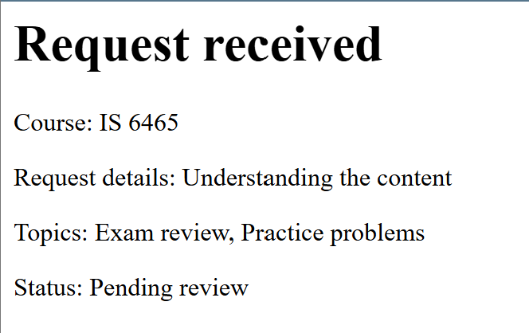

Codespaces link: https://friendly-yodel-vw47jv9776h7wj.github.dev/
Github Link: https://github.com/Tujianis/lab4

1) 
It showed a completed request, with the status of 'Pending review', showing the information previously submitted.

2) The header.php provides a base header html segment for every page that uses it. It also references the stylesheet for every page that has it.

The nav.php provides a navigation bar to go the requests and request-form webpages.

The footer.php provides a universal footer for every page that uses it.

Require_once means that the file itself is evaluated once. It functions like a dependancy would, so instead of having to constantly re-render the HTML code, it can just be rendered once and retained.

CSS file is linked in the header.php file. 

3) reason is a string value, it shows the students reason for wanting a tutor session. 

topics[] is an array that shows any of 3 options that can be selected by the user, and is an array of strings. This helps the tutor know the reason for the tutor session.

preferredtime is a string variable that selects 1 of 3 options, for the user to have their preferred timeframe for a tutor session.

preferreddate is a date variable that the user selects for the date when they can have their tutor session.

form_name is a hidden variable with a value of 'tutoring_request'. its designed to be a check for the php server to know what type of request is incoming and to add a check on the request itself. 

4) Valid Request: IS 6465, Morning, 11/06/2026, "Understand the content", "Exam Review". It was accepted, it said "Status Pending" after showing "Request Received". The business rule being checked is that a user would be able to submit a valid requests for tutoring.

Missing/Invalid Value: IS 6465, 11/10/2026, "Exam Review",no content for reason. The request was rejected. It says "Please fill out this field". Business rule being checked is that non valid requests are not submitted. 

Invalid Date: IS 6465, Morning, 10/26/2026, "Understand the content", "Exam Review". The request was rejected, with "Request could not be submitted, Preferred date cannot be in the past" message on the screen. Business rule being checked is a constraint that dates in the past are not valid inputs for the form.

5) Valid time: PASS, Missing time: PASS, Altered value: PASS, Multiple valid topics: PASS, Missing topics: PASS, Altered topic: PASS, Minimum length: PASS, Maximum length: PASS, Too short: PASS, Too long: PASS.

CRUD: Create: request-form.php. Read One: request-details.php. Read all: requests.php. Update: edit-request.php. Delete: delete-request.php.

5.1) The request-details parameter is the requestId.
5.2) GET is appropriate because when doing a READ, GET is usually the best since there is no body to send in the request, and the URL parameters can be used to read the request. All other types of requests can write, GET is read-only.
5.3) Since GET is read-only. its unable to edit information, which is what happens when you are trying to update or delete, POST is better (if you ignore PATCH and DELETE requests).